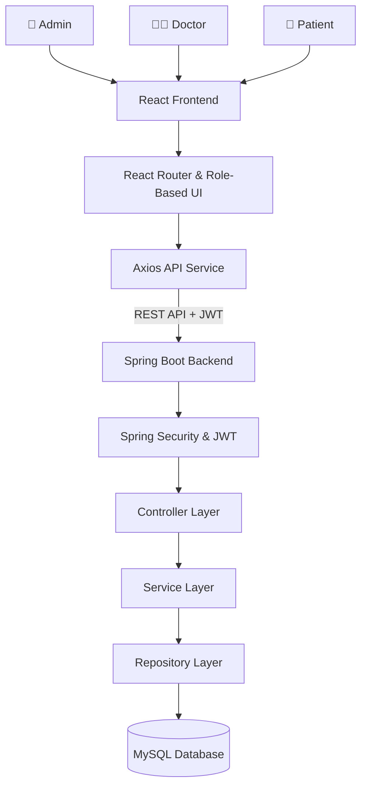
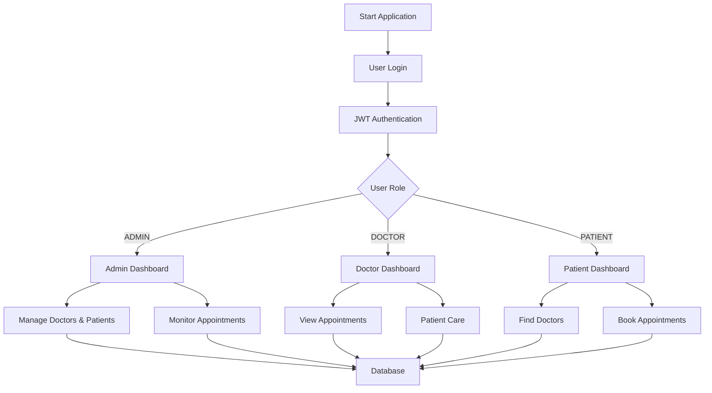

# 🏥 CURIX — Hospital Management & Patient Care System

<p align="center">
  
  
  
  
</p>

<p align="center">
  <strong>A Modern Digital Healthcare Management & Patient Care Platform</strong>
</p>

<p align="center">
  Streamlining hospital operations, doctor management, patient care, and appointment coordination through a secure and intuitive digital healthcare experience.
</p>

<p align="center">
  <a href="#-overview">Overview</a> •
  <a href="#-features">Features</a> •
  <a href="#-technology-stack">Tech Stack</a> •
  <a href="#-architecture">Architecture</a> •
  <a href="#-installation--setup">Installation</a>
</p>

---

## 📌 Overview

**CURIX** is a full-stack Hospital Management and Patient Care System designed to simplify and modernize healthcare administration.

The platform provides a centralized environment where administrators, doctors, and patients can interact through dedicated role-based interfaces.

Built with **Java Spring Boot** on the backend and **React.js** on the frontend, CURIX focuses on secure authentication, structured healthcare management, appointment coordination, and an organized patient-care workflow.

The system aims to reduce manual administrative work, improve accessibility to healthcare services, and create a seamless digital experience for hospital staff and patients.

## 🎯 Project Objectives

- Digitize hospital management operations.
- Simplify doctor and patient management.
- Streamline appointment scheduling.
- Provide dedicated dashboards for different user roles.
- Implement secure authentication and authorization.
- Organize patient information and healthcare workflows.
- Deliver a modern, responsive healthcare interface.

---

## ✨ Features

### 🔐 Authentication & Security
- JWT-based authentication.
- Secure password encryption.
- Role-based access control.
- Protected frontend routes.
- Authorized access to role-specific resources.

### 👨‍💼 Admin Management
- Dedicated administrator dashboard.
- Doctor account management.
- Add and manage doctors.
- View and manage registered patients.
- Monitor appointments.
- Track healthcare operations.

### 👨‍⚕️ Doctor Management
- Individual doctor accounts.
- Doctor-specific dashboard.
- View assigned appointments.
- Access authorized patient information.
- Manage patient-care workflows.
- Prescription management, where supported.

### 🧑‍🤝‍🧑 Patient Management
- Patient registration and authentication, where enabled.
- Dedicated patient dashboard.
- Browse available doctors.
- Book appointments.
- View appointment information.
- Access available prescription and medical information.

### 📅 Appointment Management
- Doctor selection.
- Appointment booking.
- Appointment tracking.
- Appointment status management.
- Role-based appointment access.

### 🏥 Healthcare Departments

CURIX is organized around multiple medical departments:

| Department | Specialization |
|---|---|
| Cardiology | Heart and cardiovascular care |
| Neurology | Brain and nervous system |
| Orthopedics | Bone and joint care |
| General Medicine | General healthcare |
| General Surgery | Surgical treatments |
| Pediatrics | Children's healthcare |
| Gynecology & Obstetrics | Women's healthcare |
| Dermatology | Skin and hair care |
| ENT | Ear, nose and throat |
| Dentistry | Dental healthcare |
| Nephrology | Kidney care |
| Pulmonology | Respiratory healthcare |
| Radiology | Medical imaging |
| Emergency Medicine | Emergency medical care |

---

## 🛠️ Technology Stack

### Backend

| Technology | Purpose |
|---|---|
| Java | Core programming language |
| Spring Boot | Backend application framework |
| Spring Security | Authentication and authorization |
| Spring Data JPA | Database persistence |
| Hibernate | ORM |
| MySQL | Relational database |
| JWT | Token-based authentication |
| Maven | Dependency management |
| REST APIs | Frontend-backend communication |

### Frontend

| Technology | Purpose |
|---|---|
| React.js | Component-based frontend |
| Vite | Frontend development and build tool |
| JavaScript | Frontend programming |
| React Router | Application routing |
| Axios | HTTP communication |
| Bootstrap 5 | Responsive UI components |
| Tailwind CSS | Utility-based styling |
| Lucide React | Icons |

### Development & Testing

| Tool | Purpose |
|---|---|
| Eclipse / IntelliJ IDEA | Backend development |
| VS Code | Frontend development |
| Postman | API testing |
| Swagger / OpenAPI | API documentation |
| Git & GitHub | Version control |

---

## 🏗️ System Architecture

CURIX follows a layered full-stack architecture.



### Backend Architecture

The backend follows a layered architecture to maintain separation of concerns.

```text
Backend
│
├── config
├── controller
├── dto
├── entity
├── enums
├── exception
├── repository
├── service
└── security
```

### Frontend Architecture

The frontend is organized into reusable components, pages, services, layouts, and authentication modules.

```text
Frontend
│
└── src/
    ├── assets/
    ├── components/
    ├── context/
    ├── hooks/
    ├── layouts/
    ├── pages/
    │   ├── public/
    │   ├── auth/
    │   ├── admin/
    │   ├── doctor/
    │   └── patient/
    ├── routes/
    ├── services/
    ├── styles/
    ├── utils/
    ├── App.jsx
    └── main.jsx
```

*Note: The diagrams and folder structures illustrate the intended architecture; adjust them to match the final repository structure.*

---

## 🔄 Application Workflow



---

## 🚀 Installation & Setup

Follow these steps to run CURIX locally.

### 1. Prerequisites

Make sure you have installed:

- Java Development Kit (JDK)
- Maven
- Node.js and npm
- MySQL Server
- Git
- Postman (optional)

### 2. Clone the Repository

```bash
git clone https://github.com/Rashmiranjan07/Curix.git
```

```bash
cd Curix
```

### 3. Backend Setup

Navigate to the backend directory:

```bash
cd curix-backend
```

Build the application:

```bash
mvn clean install
```

Run the Spring Boot application:

```bash
mvn spring-boot:run
```

The backend will run on the port configured in your application properties.

### 4. Database Configuration

Create a MySQL database:

```sql
CREATE DATABASE curix_db;
```

Configure your database connection in `application.properties`:

```properties
spring.datasource.url=jdbc:mysql://localhost:3306/curix_db
spring.datasource.username=YOUR_DB_USERNAME
spring.datasource.password=YOUR_DB_PASSWORD
```

Use your actual backend configuration and environment-specific settings. Never commit real credentials.

### 5. Frontend Setup

Open another terminal and navigate to the frontend directory:

```bash
cd curix-frontend
```

Install dependencies:

```bash
npm install
```

Start the development server:

```bash
npm run dev
```

Open the local URL displayed by Vite in your browser.

### 6. API Testing

Use Postman or Swagger UI to test backend endpoints.

Verify authentication, role permissions, doctor management, patient management, and appointment workflows using your actual configured API endpoints.

---

## 🔒 Security Considerations

CURIX uses security mechanisms designed to protect healthcare application workflows.

- JWT-based authentication.
- Password hashing through the configured password encoder.
- Role-based authorization.
- Protected API endpoints.
- Frontend route protection.
- Backend-side permission enforcement.
- Secure handling of application configuration.

**Important:** Frontend route protection is not a replacement for backend authorization. All sensitive operations must be validated by the backend.

---

## 🧪 Testing

The application can be tested using:

- Postman for REST API testing.
- Swagger UI for API exploration.
- Maven for backend build verification.
- Browser developer tools for frontend debugging.
- Manual testing of role-based workflows.

Recommended testing scenarios:

- Valid and invalid login.
- Unauthorized API requests.
- Admin doctor management.
- Patient appointment booking.
- Doctor appointment access.
- Invalid form submissions.
- Backend validation and error responses.

---

## 🔮 Future Enhancements

Potential improvements for future development:

- Online video consultations.
- Payment gateway integration.
- Email and SMS appointment notifications.
- Advanced medical analytics.
- Digital medical records.
- Laboratory report management.
- Pharmacy management.
- Prescription PDF generation.
- Docker-based deployment.
- Cloud hosting and CI/CD automation.

---

## 🎨 Design Philosophy

CURIX aims to deliver a modern healthcare experience through:

- Clean and intuitive user interfaces.
- Professional medical-themed design.
- Responsive dashboard layouts.
- Consistent typography and spacing.
- Role-specific user experiences.
- Accessible navigation.
- Clear healthcare information presentation.

---


## 📄 License

This project is developed for educational and academic purposes.

Add a LICENSE file to the repository if you intend to distribute it under a specific open-source license.

---

<p align="center">
  <strong>CURIX — Advancing Healthcare Through Technology.</strong>
  <br/>
  <sub>Designed to connect healthcare professionals and patients through a unified digital platform.</sub>
</p>

<p align="center">
  ⭐ If you find this project interesting, consider giving the repository a star!
</p>
